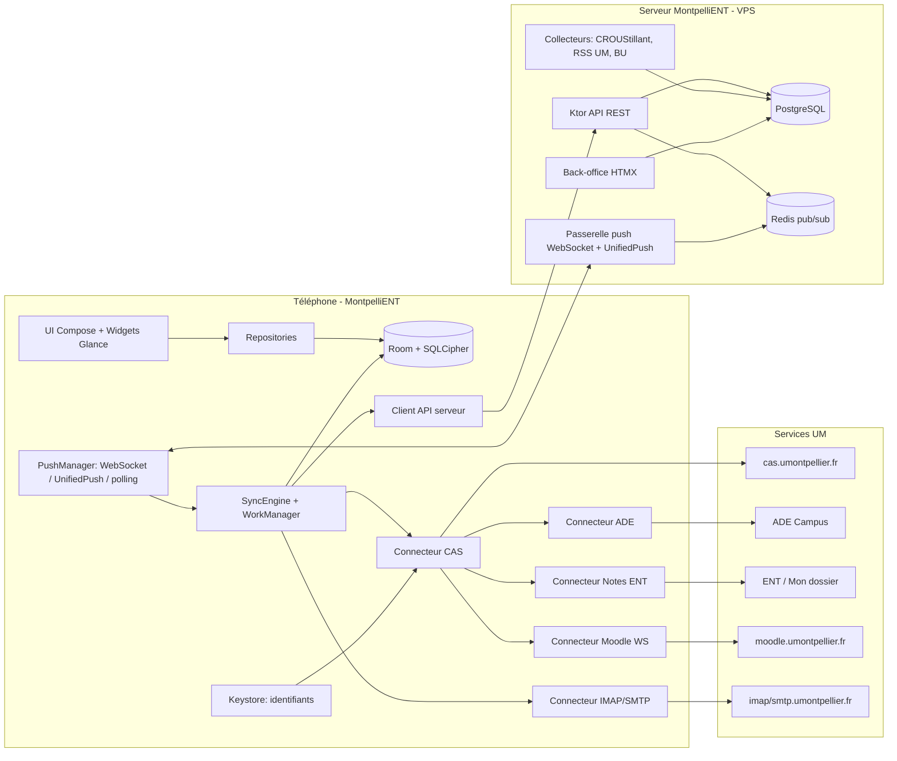

# MontpelliENT — Plan d'implémentation

Application Android **non officielle et open source**, un « Pronote » pour les étudiants de l'Université de Montpellier, avec un serveur associé. Distribution en APK (GitHub Releases / F-Droid). L'appli affiche clairement qu'elle **n'est pas affiliée à l'UM**.

> [!IMPORTANT]
> Principe de sécurité central : **les identifiants universitaires ne quittent jamais le téléphone.** L'appli récupère elle-même toutes les données personnelles (EDT, Moodle, notes, mails). Le serveur ne gère que des données publiques ou partagées (CROUS, actualités, BU, associations, affluence) et le push.

---

## 1. Décisions validées

| # | Sujet | Décision |
|---|---|---|
| 1 | Appli mobile | Kotlin + Jetpack Compose (Material 3, Glance, WorkManager, Room) |
| 2 | Architecture | Hybride : CAS et données privées sur l'appareil ; serveur pour les données publiques et le push |
| 3 | Serveur | Kotlin + Ktor, PostgreSQL, Redis, Docker Compose, module `shared` commun |
| 4 | Push | **Système maison sans Google** sur 3 niveaux : WebSocket Ktor → UnifiedPush → interrogation périodique avec WorkManager |
| 5 | Statut | Projet personnel ou associatif, open source, APK / F-Droid (aucune dépendance propriétaire) |
| 6 | Développement | Vous avez un compte UM ; outil de capture HTML anonymisée en build debug ; mode démo |
| 7 | Connexion | Formulaire CAS natif, mot de passe chiffré par le Keystore (+ biométrie en option), bascule sur WebView en cas de double authentification ou captcha |
| 8 | EDT ADE | Interrogé **directement par l'appli**, changements détectés à chaque synchro locale |
| 9 | Moodle | API officielle Moodle Mobile (jeton via `launch.php`) : cours et contenus, devoirs et statut, notes, annonces, fichiers hors ligne. Dépôt de devoirs **plus tard** |
| 10 | Notes | **Affichage simple** des notes officielles (pas de moyenne ni de simulateur) |
| 11 | Mails | Client IMAP/SMTP intégré complet + assistant d'activation « SMTP-IMAP authentifié » |
| 12 | CROUS | Menus (CROUStillant mis en cache par le serveur), infos des RU et RU favori, **affluence collaborative** |
| 13 | Campus | Actus et agenda UM (RSS), événements des associations, **horaires et disponibilité des BU** |
| 14 | Back-office | Ktor + HTMX, rôles admin/organisateur, modération, argon2 + TOTP |
| 15 | Navigation | Material 3 adaptative, tableau de bord Accueil, 4 onglets configurables + « Plus », recherche globale |
| 16 | Thèmes | Material You, palettes (dont « UM »), couleur libre, clair/sombre/AMOLED, contraste, couleurs par matière |
| 17 | Widgets | Prochain cours, EDT jour/semaine, Dernières notes (floutables), Mails non lus |
| 18 | Synchro | Offline-first, Room = source de vérité, politiques de fraîcheur par source, base SQLCipher |
| 19 | Hébergement | VPS + Docker Compose (Ktor, PostgreSQL, Redis, Caddy), CI GitHub Actions |
| 20 | Compatibilité | minSdk 26, targetSdk = dernière version stable, **FR + EN dès la V1** |
| 21 | Build | JDK 21 + SDK Android installés sans sudo dans `~/.jdks` et `~/Android` |
| 22 | Nom | **MontpelliENT**, package `fr.montpellient.app` |
| 23 | Livraison | 8 jalons (J0 à J7), une démo à chaque jalon |

---

## 2. Architecture



### Arborescence du dépôt (un seul build Gradle)

```
app_etudiante_ent/
├── gradle/libs.versions.toml          # catalogue de versions
├── shared/                            # DTO kotlinx.serialization + protocole push (JVM, commun appli/serveur)
├── android/
│   ├── app/                           # MainActivity, NavHost adaptatif, DI (Hilt)
│   ├── core/{model,database,network,security,sync,designsystem,notifications,push,i18n}
│   ├── connector/{cas,ade,moodle,mail,grades,backend}
│   ├── feature/{onboarding,home,timetable,courses,grades,mail,crous,campus,search,settings,devtools}
│   └── widget/                        # widgets Glance
├── server/                            # Ktor : api, jobs, push, backoffice, migrations Flyway
├── deploy/{docker-compose.yml,Caddyfile,.env.example}
├── docs/{ARCHITECTURE.md,CONNECTORS.md,PRIVACY.md,DEPLOY.md}
└── .github/workflows/{android.yml,server.yml}
```

---

## 3. Application Android

### 3.1 Connexion et sécurité — `connector/cas`, `core/security`
- **Client CAS natif** (OkHttp + jar de cookies persistant chiffré) : `GET /cas/login?service=…` → lecture du formulaire (`execution`, champs cachés) avec Jsoup → `POST` → récupération du TGC. Les tickets de service sont obtenus à la demande pour chaque service.
- **Re-login silencieux** : intercepteur OkHttp qui repère une redirection vers le CAS, se reconnecte une seule fois (mutex) puis rejoue la requête.
- **Bascule WebView** si la page de retour n'est pas reconnue (double authentification, captcha, changement de mot de passe obligatoire). On récupère alors les cookies de la WebView.
- Mot de passe chiffré en AES-GCM avec une clé du **Android Keystore** (StrongBox si disponible), stocké dans DataStore. Option « déverrouillage biométrique ». Clé SQLCipher protégée par le Keystore. `allowBackup=false`, logs nettoyés de toute donnée personnelle.

### 3.2 Connecteurs (interface commune `Connector<T>` : `fetch()`, `health()`, fixtures de test)
| Connecteur | Méthode | Points clés |
|---|---|---|
| **ADE** | Lien iCal obtenu depuis l'ENT (« Planning ») après connexion CAS, ou collé à la main | Parseur ICS léger, diff par `UID` + hash → notifications locales (salle changée, cours annulé ou ajouté) |
| **Moodle** | `admin/tool/mobile/launch.php?service=moodle_mobile_app&passport=…&urlscheme=moodlemobile` dans la WebView, interception de `moodlemobile://token=…`, vérification de la signature | Fonctions WS : `core_webservice_get_site_info`, `core_enrol_get_users_courses`, `core_course_get_contents`, `mod_assign_get_assignments`, `mod_assign_get_submission_status`, `gradereport_user_get_grade_items`, `mod_forum_get_forum_discussions`, `core_calendar_get_action_events_by_timesort` ; fichiers via `pluginfile.php?token=` |
| **Notes** | Lecture HTML de la page ENT de votre composante (Jsoup) | Adaptateurs interchangeables (`GradesAdapter`), le premier est réglé sur vos captures ; détection des nouvelles notes ; relevés PDF |
| **Mails** | Angus/Jakarta Mail : IMAPS `imap.umontpellier.fr:993`, SMTP STARTTLS `smtp.umontpellier.fr:587` | Dossiers, recherche côté serveur, pièces jointes, rédaction/réponse, IDLE quand l'appli est au premier plan ; HTML affiché dans une WebView isolée (JS désactivé, images distantes bloquées par défaut) |
| **Serveur** | REST JSON (types du module `shared`) | CROUS, actus, BU, événements, affluence ; requêtes ETag |

### 3.3 Moteur de synchronisation — `core/sync`
- **Room = source de vérité**, les écrans observent des `Flow` (stale-while-revalidate).
- `SyncEngine` : orchestre les connecteurs en parallèle (coroutines, limite de concurrence), avec une session CAS partagée et des requêtes conditionnelles (ETag / If-Modified-Since), puis un *upsert* transactionnel avec empreinte pour détecter les changements → `ChangeEvent` → notifications locales et mise à jour des widgets.
- Politiques de fraîcheur : EDT 30 min · Moodle 1 h · notes 2 h · mails IDLE/15 min · CROUS 6 h · campus 1 h (réglables).
- WorkManager : tâche périodique plus tâches ponctuelles déclenchées par le push. Contraintes : batterie non faible, Wi-Fi pour les gros fichiers. Backoff exponentiel.
- Écran **« Santé des connecteurs »** : dernier succès, erreurs, durée, bouton « réessayer ».

### 3.4 Push maison — `core/push`
1. **WebSocket** vers `/v1/push/ws` depuis un service au premier plan (désactivé par défaut ; type `dataSync`/`specialUse` selon l'API cible), avec ping/pong et reconnexion progressive.
2. **UnifiedPush** : si un distributeur est installé (ntfy, NextPush…), on enregistre l'endpoint sur le serveur (charges utiles chiffrées en Web Push, RFC 8291).
3. **Interrogation de secours** : WorkManager toutes les 15 min sur `/v1/push/pending?since=seq`.
- Messages numérotés (`seq`) et rejouables : au retour en ligne, le client envoie le dernier `seq` reçu. Le push contient seulement un *signal* (« crous.menu.updated », « event.new », « broadcast ») qui déclenche une synchro ciblée.

### 3.5 Interface, navigation, thèmes, widgets
- **Navigation adaptative** (`NavigationSuiteScaffold`) : barre du bas, rail ou tiroir selon la taille d'écran. Onglets : Accueil + 4 au choix + « Plus ».
- **Accueil** : cartes réorganisables par glisser-déposer (prochain cours, devoirs à rendre, dernières notes, menu du RU, mails non lus, événements).
- Écrans : EDT (jour, semaine, liste, détail du cours), Cours (liste → sections → ressources, devoirs), Notes, Mails, CROUS (liste des RU, menu, carte OSM, affluence), Campus (actus, agenda, assos, BU), Réglages, **Recherche globale** (index Room FTS4).
- **Thèmes** : Material You (API 31+), palettes prédéfinies dont « UM », couleur source libre (material-color-utilities), clair/sombre/AMOLED, contraste standard/moyen/élevé, couleur par matière.
- **Widgets Glance** : Prochain cours (2x1/3x1), EDT jour/semaine (redimensionnable, défilant), Dernières notes (floutage en option), Mails non lus. Ils suivent le thème de l'appli.
- **i18n** : `values/` (FR) et `values-en/` (EN), choix de la langue dans l'appli (API 33 + AppCompat).
- **Mode démo** (données fictives) et **outil de capture debug** : enregistre les réponses HTML, remplace les noms, numéros étudiant, INE et e-mails, puis exporte un zip à partager ; ces captures deviennent les fixtures des tests des parseurs.

---

## 4. Serveur — `server/`
- **Stack** : Ktor 3 (Netty), Exposed + Flyway, PostgreSQL 16, Redis 7, kotlinx.serialization, Koin, OpenAPI.
- **Identité anonyme des appareils** : `POST /v1/devices` → `deviceId` aléatoire + jeton porteur. Aucune donnée personnelle. Sert aux abonnements push et à limiter le débit de l'affluence.
- **API** : `/v1/crous/restaurants`, `/v1/crous/restaurants/{id}/menus`, `/v1/crous/affluence` (GET/POST), `/v1/campus/news`, `/v1/campus/events`, `/v1/bu`, `/v1/push/{ws,pending,subscriptions,unifiedpush}`, `/health`.
- **Collecteurs planifiés** : CROUStillant toutes les 6 h (User-Agent avec contact, respect de la limite de 200 req/min, filtre Montpellier-Occitanie) ; RSS UM et composantes toutes les 30 min ; horaires et disponibilité des BU (site des BU de l'UM ; service Affluences s'il est utilisé, **à vérifier**). Chaque mise à jour publie un signal push.
- **Affluence collaborative** : signalement sur 3 niveaux, 1 signalement par appareil par RU toutes les 10 min, agrégation pondérée qui s'efface en 20–30 min.
- **Back-office** (`/admin`, kotlinx.html + HTMX) : inscription des associations → validation par l'admin ; CRUD des événements (affiche redimensionnée et stockée sur un volume), file de modération, statut « organisateur de confiance », message à tous ; argon2id + TOTP, sessions sécurisées, CSRF.
- **Déploiement** : `docker-compose` (server, postgres, redis, caddy), sauvegarde `pg_dump` quotidienne, `.env` pour les secrets.

---

## 5. Jalons

| Jalon | Contenu | Démo / validation |
|---|---|---|
| **J0** | Installation de JDK 21 et du SDK Android, build multi-modules, design system et thèmes de base, navigation, **mode démo** | APK installé sur l'émulateur, navigation complète avec données fictives |
| **J1** | Connexion CAS (natif + WebView), Keystore et biométrie, SQLCipher, `SyncEngine`, **EDT ADE**, Accueil, outil de capture | Connexion avec votre compte, EDT réel affiché hors ligne |
| **J2** | Moodle : jeton, cours et contenus, devoirs et statut, notes Moodle, annonces, fichiers hors ligne | Vos cours et devoirs réels |
| **J3** | Mails IMAP/SMTP + assistant d'activation | Lecture et envoi d'un mail réel |
| **J4** | Notes ENT (adaptateur réglé sur vos captures) | Vos notes officielles |
| **J5** | Serveur complet : CROUS, affluence, actus, BU, back-office, push sur 3 niveaux, Docker | `docker compose up` en local, push reçu sur un émulateur sans Google Play |
| **J6** | Widgets Glance, personnalisation avancée, recherche globale, traduction EN | Widgets sur l'écran d'accueil, changement de thème et de langue |
| **J7** | Durcissement (sécurité, accessibilité, performances), tests, CI (APK signé + image Docker), docs, **v1.0** | Release GitHub |

---

## 6. Vérification
- **Tests unitaires** : parseurs (ICS, HTML notes/ENT, réponses Moodle) sur des fixtures anonymisées ; diff et détection de changements ; politiques de synchro ; client CAS sur un faux serveur (MockWebServer).
- **Tests UI** : Compose UI tests + Robolectric, captures d'écran de référence (Roborazzi) pour les thèmes clair/sombre et FR/EN.
- **Serveur** : tests d'intégration Ktor `testApplication` + Testcontainers (PostgreSQL, Redis), tests du protocole push (reconnexion, rejeu par `seq`).
- **Manuel** : émulateur avec Google Play et image AOSP **sans Google**, plus votre compte réel à chaque jalon ; mesure du temps de démarrage à froid et de la durée d'une synchro complète.

---

## 7. Risques et points ouverts

> [!WARNING]
> - **Pages ENT, ADE et notes non documentées** : elles peuvent changer sans préavis. Parades : adaptateurs isolés, tests sur fixtures, écran de santé, mise à jour rapide de l'APK.
> - **Double authentification CAS** (si l'UM la généralise) : la synchro en arrière-plan peut demander une reconnexion manuelle. Elle est gérée par la WebView et une notification « reconnexion requise ».
> - **Moodle** : si l'UM limite le `urlscheme` ou désactive `launch.php`, il faudra revenir à la session web Moodle et lire les pages.
> - **Conditions d'utilisation de l'UM** : usage raisonnable (cadence limitée, User-Agent identifiable). Contacter la DSIN (`contact-dsin@umontpellier.fr`) reste conseillé.
> - **Batterie** : le WebSocket permanent est facultatif et désactivé par défaut. UnifiedPush ou l'interrogation périodique sont recommandés.

**À préciser pendant les jalons** (sans bloquer le démarrage) : votre composante et la page exacte des notes (J4), l'outil de disponibilité utilisé par les BU (J5), le nom de domaine du VPS (J5/J7).
